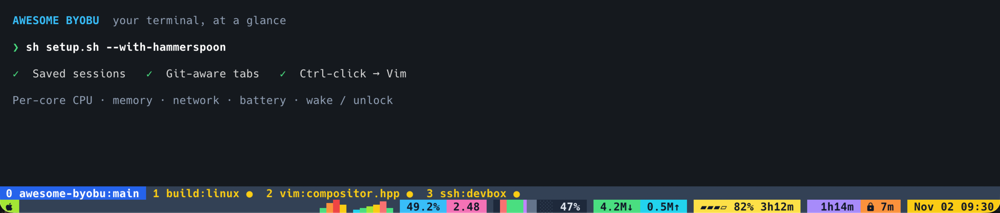

# Awesome Byobu



*Actual iTerm2/tmux screenshot with demo metrics. CPU, memory, network, battery
and wake/unlock indicators share the lower row; workspaces fill the row above.*

Byobu/tmux with readable tabs, live CPU/RAM/battery stats, saved sessions, and
source links that open Vim at the right line.

## Huge thanks to Dustin Kirkland and the original Byobu project

This setup builds on **[Byobu](https://github.com/dustinkirkland/byobu)**.
A huge thank you to **[Dustin Kirkland](https://github.com/dustinkirkland)**
([kirkland@byobu.org](mailto:kirkland@byobu.org)) and all Byobu contributors for
the terminal environment that makes this project possible.

The name refers to **byōbu (屏風)**, Japanese folding screens made of joined,
often decorated panels—a fitting image for a terminal with multiple workspaces.
Read about [Japanese byōbu](https://en.wikipedia.org/wiki/By%C5%8Dbu), or visit
the [original Byobu project](https://www.byobu.org/).

**macOS is the primary supported environment:** macOS 15+ on Apple Silicon,
Homebrew and iTerm2. Linux installers target Fedora 43+, Ubuntu 24.04+,
Debian 12+, and current Arch, using Konsole and systemd user services.
Intel Macs and real Linux desktop integration still need target-machine testing.

## Start from scratch on macOS

Open **Terminal**, paste this one line, and follow the installer prompts:

```sh
sh -c "$(curl -fsSL https://raw.githubusercontent.com/jpietek/awesome-byobu/main/bootstrap.sh)"
```

No Git, Python, Byobu or Homebrew installation is needed beforehand. Setup
downloads the project, installs Homebrew and Apple Command Line Tools if needed,
installs packages and fonts, configures iTerm, enables services, checks live
stats, and opens your terminal. Run as your normal user; macOS/Homebrew may ask
for an administrator password or a developer-tool installation dialog.

**With optional terminal mouse/trackpad controls and Ctrl-click links:**

```sh
sh -c "$(curl -fsSL https://raw.githubusercontent.com/jpietek/awesome-byobu/main/bootstrap.sh)" -- --with-hammerspoon
```

Allow **Hammerspoon** in **System Settings → Privacy & Security → Accessibility**,
then choose **Reload Config** from its menu. Allow Input Monitoring if requested.
Hammerspoon is optional: Byobu, Cmd-click links and iTerm keyboard bindings work
without it.

After installation, launch **Terminal setup** from `~/Applications` or Spotlight.
It opens the correct iTerm profile and reattaches your saved session. You can
also run `~/.local/bin/start-byobu` in an existing terminal.

## macOS customizations

The **Terminal setup** profile includes Hack Nerd Font Mono at size 13, the
supplied palette, 75% opacity, two status rows, directory/Git tab names and
automatic session saves. Your personal Zsh settings load first.

### Normal keyboard bindings

`Ctrl+A, c` means press Ctrl+A, release it, then press c.

| Shortcut | Action |
|---|---|
| Ctrl+A, c | New Byobu tab in the current directory |
| Ctrl+A, 0…9 | Select that numbered Byobu tab |
| Ctrl+A, n / p | Next / previous Byobu tab |
| Ctrl+A, d | Detach; programs keep running |
| Ctrl+A, a | Send literal Ctrl+A to the application |
| F12 | Alternative prefix; macOS may require Fn+F12 |
| Ctrl+R | Shell history search |
| Ctrl+C / Ctrl+D | Normal terminal interrupt / EOF |
| Ctrl+Shift+C / Ctrl+Shift+V | Copy selection / paste via iTerm |
| Cmd+C / Cmd+V | Native iTerm copy / paste |
| Ctrl+Left / Ctrl+Right | Move by word at the managed Zsh prompt |
| Page Up or Ctrl+Up | Enter Byobu scrollback and page up |
| Page Down or Ctrl+Down | Page down while in scrollback |
| Ctrl+A, [ | Enter vi-style copy mode; `q` exits |
| Shift+Up / Shift+Down in copy mode | Scroll five lines |
| Space / b in copy mode | Page down / up |
| Ctrl+A, o | Open an HTTP(S) URL from the clipboard |
| Cmd-click a source path | Open Vim in a new Byobu tab at `:line[:column]` |
| Cmd-click an HTML path | Open the local HTML file in a browser |
| Cmd-click an image, PDF or other file | Open with its default application |

Full-screen programs retain their own Page Up/Page Down behavior. tmux mouse
mode is off so iTerm can select text. Standard Byobu F-key bindings are retained.
No physical Fn, Command or Option remapping is installed.

### Optional Hammerspoon controls

Installed only with `--with-hammerspoon`. These controls apply to **iTerm2**;
other apps keep their shortcuts. The one global shortcut toggles iTerm.

| Shortcut / gesture | Action |
|---|---|
| Ctrl+` | Show/hide iTerm; open Terminal setup if it has no windows |
| Ctrl+Alt+0…9 | Select a Byobu tab directly |
| Ctrl+Shift+C / V | Native Copy / Paste, also provided through Hammerspoon |
| Middle mouse click | Paste into the focused iTerm window |
| Short, stationary three-finger tap or click | Paste into the focused iTerm window |
| Ctrl-click | Open the link under the pointer, like Cmd-click |

Paste uses iTerm's native action, retaining bracketed-paste and confirmation
behavior. Moving focus before the paste cancels it. Three-finger swipes are
not mapped. If macOS consumes taps, change conflicting Look Up or three-finger
drag settings. Some Macs require restarting Hammerspoon after sleep to restore
gesture delivery.

Setup preserves and backs up `~/.hammerspoon/init.lua`, adding a loader. Remove
`require("awesome_byobu").start()` and reload Hammerspoon to disable it. Custom
Hammerspoon config-directory overrides need the loader copied there manually.

### Source links, images, documents and URLs

Examples to print or copy into your terminal:

```text
src/mixer/primitives/compositor_layers.hpp:205
src/nodes/hwaccel/cuda_rect_frame.hpp:78
tests/cuda/nvdec/compositor_crop.py
docs/link-test.html
docs/images/awesome-byobu-macos-demo.png
https://example.com/
```

Use native **Cmd-click**, or **Ctrl-click** through optional Hammerspoon. These
names refer to the modifiers macOS receives. If your existing keyboard setup
swaps Option and Command, use the **physical Option key + click** for native
Cmd-click. This works without the Hammerspoon bridge and is the fallback if
Ctrl-click is unreliable. Awesome Byobu does not install that modifier swap.

Source links open Vim
in a new **Byobu tab in the same session**. `file.cpp:78:5` also selects the column.
Relative paths resolve from the active pane, then its Git repository root.
Absolute paths and local `file://` links work too. These are local files:
SSH-only files are not downloaded. Missing paths produce an error.

The link prefix and file type choose the application:

| Link / file type | Opens with |
|---|---|
| `http://…`, `https://…`, local `.html` / `.htm` | Browser |
| Code such as `.hpp:78`, `.cpp`, `.cu`, `.py`, `.js`, `.rs`, `.sh` | Vim in a new Byobu tab, at the requested line/column |
| Text/config such as `.txt`, `.md`, `.json`, `.yaml`, `.toml`, `.log`, `Makefile`, `Dockerfile`, `.gitignore` | Vim in a new Byobu tab |
| Images: `.png`, `.jpg`, `.jpeg`, `.gif`, `.webp`, `.svg`, `.heic`, etc. | Default image application |
| PDFs, office documents, audio/video, archives and unknown extensions | Default application for that file type |
| Directories | Default file manager |

On macOS, default-app opening uses `open`; Linux uses `xdg-open`. A `:line`
suffix does not turn an image or PDF into a Vim link. Absolute paths to images,
documents and HTML work even without an attached Byobu session.

`.html` / `.htm` and HTTP(S) links use installed **Chromium**, then **Google
Chrome**, then the default browser. No browser is installed or made the system
default. Set `"browser": "Chromium"` in `~/.config/awesome-byobu/links.json` to
require that Mac app. Native OSC 8 web links may use iTerm's default URL handler.

From a checkout, try `README.md:1` and `docs/link-test.html`. Preview the action:

```sh
~/.local/bin/terminal-open-link --dry-run README.md:1
```

iTerm's [Smart Selection](https://iterm2.com/documentation-smart-selection.html)
and [Semantic History](https://iterm2.com/documentation-preferences-profiles-advanced.html)
detect these references. This does not change links inside chat apps or browsers.

## Start from scratch on Linux

Use a **logged-in desktop account with sudo**, systemd user services and D-Bus.
These one-liners install download tools first; setup installs the rest and opens
Konsole. Yakuake can use the same profile. This configures an installed desktop;
it does not install Linux. Bare servers, containers, WSL and non-systemd systems
are not claimed as complete desktop installations.

**Fedora / Fedora Asahi (DNF):**

```sh
sudo dnf install -y ca-certificates tar gzip && (command -v curl >/dev/null || sudo dnf install -y curl) && sh -c "$(curl -fsSL https://raw.githubusercontent.com/jpietek/awesome-byobu/main/bootstrap.sh)"
```

**Ubuntu / Debian (APT):**

```sh
sudo apt-get update && sudo apt-get install -y curl ca-certificates tar gzip && sh -c "$(curl -fsSL https://raw.githubusercontent.com/jpietek/awesome-byobu/main/bootstrap.sh)"
```

**Arch (pacman):**

```sh
sudo pacman -Syu --needed curl ca-certificates tar gzip && sh -c "$(curl -fsSL https://raw.githubusercontent.com/jpietek/awesome-byobu/main/bootstrap.sh)"
```

Arch performs a full system upgrade. Byobu is currently an
[AUR package](https://aur.archlinux.org/packages/byobu), so setup builds
checksum-verified upstream **Byobu 7.19** into `~/.local/opt/byobu-7.19`.
No AUR helper is needed. Its mobile companion is disabled at build time.

Launch **Terminal setup** from the application menu. Shared Byobu keys, metrics
and persistence are included. Ctrl-click integration and Hammerspoon gestures
are macOS/iTerm features; `terminal-open-link` also works as a Linux command.
Linux CPU quota enforcement is not implemented.

## Packages and prerequisites

Package managers install transitive dependencies. Fonts and pinned tmux plugins
are bundled. No `pip install` is required.

| Environment | Direct packages |
|---|---|
| macOS / Homebrew | `byobu tmux python git vim`, cask `iterm2`; Apple Command Line Tools for Clang. macOS supplies Bash, Zsh and Perl. Optional cask: `hammerspoon`. |
| Fedora / DNF | `gcc make python3 byobu tmux bash zsh perl perl-Fcntl procps-ng which git vim python3-gobject-base fontconfig xdg-utils wl-clipboard xclip konsole yakuake ca-certificates tar gzip` |
| Ubuntu/Debian / APT | `build-essential python3 byobu tmux bash zsh perl procps debianutils git vim python3-gi gir1.2-glib-2.0 fontconfig xdg-utils wl-clipboard xclip konsole yakuake curl ca-certificates tar gzip` |
| Arch / pacman | `base-devel python tmux bash zsh perl procps-ng which git vim python-gobject fontconfig xdg-utils wl-clipboard xclip konsole yakuake curl ca-certificates tar gzip autoconf automake gettext libnewt`; Byobu built from source. |

Runtime needs Python 3.9+, tmux 3.2+, Byobu, Zsh, Bash and Perl/Fcntl. Linux
events use the distro's Python GObject package. Git supplies branch names; Vim
opens source. Wayland clipboard uses `wl-clipboard`; X11 uses `xclip`.
Ubuntu needs Universe enabled for Konsole/Yakuake. Agent CLIs such as Codex and
Claude are separate installations.

Print exact dependency commands without installing anything:

```sh
sh setup.sh --print-deps macos   # also: fedora, ubuntu, debian, arch
```

## ZIP, existing checkout, and updates

Download and extract the GitHub ZIP. On Mac, double-click **Setup.command**.
Or open a terminal in the extracted folder on any supported OS:

```sh
sh setup.sh                     # dependencies, build, install, verify, open
sh setup.sh --with-hammerspoon  # macOS gestures and Ctrl-click
sh setup.sh --no-open           # install/verify without opening a window
sh setup.sh --with-cpu-limit    # optional Apple Silicon job CPU limiter
```

Rerun to update. Replaced files are backed up under
`~/.local/state/terminal-setup/install-backups/`. Personal shell rc files and
`~/.config/byobu/local.tmux` are preserved. Saved history stays private.
Setup uses its own tmux socket; other sessions are not imported or killed.
For a custom Mac installation, see [applying only link controls](docs/macos-existing.md).

## Verify and troubleshoot

```sh
~/.local/bin/terminal-setup-check
~/.local/bin/terminal-stats status
```

Mac logs: `~/.local/state/terminal-setup/logs/`. Linux:
`systemctl --user status terminal-metrics.service terminal-events.service`.
If setup stops for Command Line Tools or a permission, complete that step and
rerun. For Ubuntu with disabled Universe: `sudo add-apt-repository universe`.
Use `sh setup.sh` if macOS prevents double-clicking the downloaded launcher.

Development checks, without activating desktop services:

```sh
sh build.sh
python3 -m unittest discover -s tests -v
sh setup.sh --stage /tmp/awesome-byobu-preview
lua tests/hammerspoon.lua        # optional test dependency: Lua 5.3+
```

Mac builds, isolated installs, link routing and simulated input are tested
locally. Linux metrics/services have fixture coverage; CI defines Linux build
and staging jobs. Fresh Mac dependency bootstrap, Intel hardware and real Linux
desktop activation require target-machine validation. See
[implementation notes](docs/architecture.md) and [Asahi notes](docs/fedora-asahi.md).
